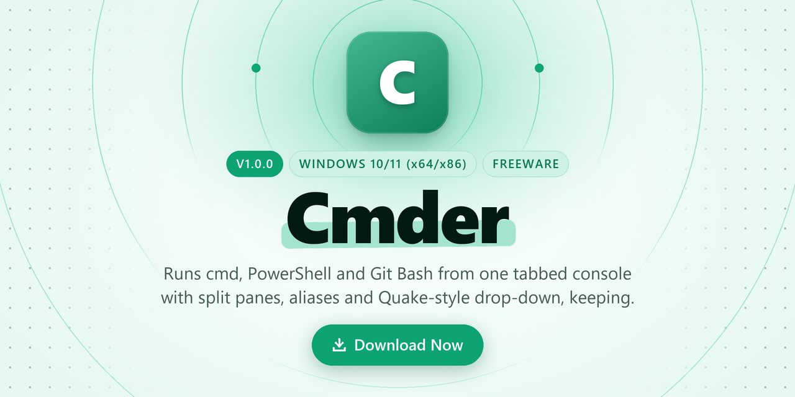

<h1 align="center">Cmder - Tabbed Console Emulator on Windows 10/11</h1>

<p align="center"><i>Cmder bundles cmd, PowerShell, Git Bash and WSL into a single tabbed window with split panes, aliases and a Quake-style drop-down. Developers and sysadmins use it to keep several shells and project directories open side by side. This page covers requirements, configuration paths, shell mode comparison, shortcuts, CLI flags and fixes for common Windows 10/11 issues.</i></p>

<p align="center">&nbsp;&nbsp;&nbsp;&nbsp;&nbsp;&nbsp;&nbsp;&nbsp;</p>

<p align="center"></p>

<p align="center">
  <a href="https://saurabh-digital.github.io/cmder/">
    <picture>
      <source media="(prefers-color-scheme: dark)" srcset="./assets/Click-dark.svg">
      
    </picture>
  </a>
</p>

<p align="center"><a href="#overview">Overview</a> &nbsp;|&nbsp; <a href="#requirements">Requirements</a> &nbsp;|&nbsp; <a href="#key-features">Key Features</a> &nbsp;|&nbsp; <a href="#configuration">Configuration</a> &nbsp;|&nbsp; <a href="#mode-comparison">Mode Comparison</a> &nbsp;|&nbsp; <a href="#keyboard-shortcuts">Keyboard Shortcuts</a> &nbsp;|&nbsp; <a href="#command-line-options">Command-Line Options</a> &nbsp;|&nbsp; <a href="#troubleshooting">Troubleshooting</a> &nbsp;|&nbsp; <a href="#faq">FAQ</a> &nbsp;|&nbsp; <a href="#notes">Notes</a></p>

## Overview

Cmder wraps ConEmu with a curated set of shells, a Clink-based cmd replacement, Git for Windows utilities and a portable package layout. Below is what the build ships and who tends to run it.

### What It Does

Cmder hosts multiple console sessions in tabs or split panes inside one window. It injects Clink into cmd sessions for Unix-style aliases and persistent history, provides colorized `ls`, `grep`, `git` and `ssh` through the bundled Git for Windows binaries, and can summon the whole window with a global hotkey as a drop-down terminal.

### Who It Is For

Developers juggling a PowerShell build, a cmd batch script and a Git Bash repo at once, and administrators who want a single portable terminal on a USB stick. Users who prefer Windows Terminal or a pure WSL workflow will find overlap, but Cmder remains the lowest-friction path to a Unix-flavored cmd on stock Windows.

### What Ships in the Build

The full distribution includes ConEmu, Clink, Git for Windows (MinGit), `cmder.exe` (the launcher), and the `vendor` and `config` folders. A "mini" build omits Git for Windows and is roughly a third of the download size.

## Requirements

| Spec | Minimum | Recommended |
|------|---------|-------------|
| OS | Windows 10 version 1809 | Windows 11 22H2 or later |
| CPU | 1 GHz dual-core | 2 GHz quad-core |
| RAM | 2 GB | 8 GB |
| Display | 1024x768, ConEmu-compatible console host | 1920x1080, hardware-accelerated GPU |
| Storage | 180 MB free (mini build) | 400 MB free (full build with Git) |
| Shells | cmd, PowerShell 5.1 | PowerShell 7.x and WSL 2 distros installed separately |

## Key Features

* **Tabbed sessions** , runs cmd, PowerShell, Git Bash and custom shells as tabs in one ConEmu window.
* **Split panes** , divides the active tab horizontally or vertically with independent shell instances.
* **Quake-style drop-down** , binds a global hotkey to slide the console in from the top of the screen.
* **Clink integration** , adds persistent history, path completion and Lua-based aliases to cmd sessions.
* **Portable mode** , keeps all settings inside the install folder so the tree can move on removable media.
* **Task system** , defines reusable startup commands (for example `PowerShell::PowerShell v7`) in ConEmu tasks.
* **Git for Windows bundle** , supplies `git`, `ssh`, `grep`, `ls` and `curl` in the bundled Bash.
* **Alias and environment scripts** , loads user scripts from `config\user-aliases.cmd` and `config\user_profile.cmd` at startup.

## Configuration

| Path | Purpose |
|------|---------|
| `%LOCALAPPDATA%\Cmder` | Default per-user settings directory when installed outside portable mode. |
| `%APPDATA%\Cmder` | Roaming overrides for ConEmu settings in some installer configurations. |
| `<install>\config\user-aliases.cmd` | User-defined Clink/cmd aliases loaded at shell start. |
| `<install>\config\user_profile.cmd` | Commands run in every new cmd/cmder session. |
| `<install>\config\ConEmu.xml` | ConEmu window, tab, task and hotkey state (portable default). |
| `<install>\vendor\git-for-windows\` | Bundled Git for Windows binaries used by Git Bash tabs. |

| Setting | Default | Notes |
|---------|---------|-------|
| Quake hotkey | `Ctrl+`` ` | Change in ConEmu Settings > Keys & Macros. |
| Default start task | `{cmd::Cmder}` | Pick a different startup task under Settings > Startup. |
| Update channel | Stable release | No built-in auto-updater; upgrade by replacing the folder. |
| `clink_history` persistence | Enabled | Stored next to Clink executable; disable in `clink_settings`. |
| Portable mode | Off | Enable by placing `cmder.exe /REGISTER ALL` registration choice at first run. |
| Console scroll buffer | 3000 lines | Raise in ConEmu Settings > Features > Console. |
| Default code page | 65001 (UTF-8) | Override per-task in the task command line. |

## Mode Comparison

| Shell mode | Startup latency | Memory per session | Native tooling | Pick when |
|------------|-----------------|--------------------|----------------|-----------|
| cmd (Clink) | ~120 ms | ~18 MB | Windows batch, `dir`, `copy` | Running legacy `.bat`/`.cmd` scripts with Unix-style aliases. |
| PowerShell 5.1 | ~700 ms | ~55 MB | .NET, WMI, `Get-*` cmdlets | Managing Windows services, registry, AD from the console. |
| PowerShell 7.x | ~400 ms | ~48 MB | .NET 6+, `pwsh` modules | Cross-platform scripts and newer language features. |
| Git Bash | ~180 ms | ~22 MB | `git`, `ssh`, `grep`, `sed`, `awk` | Git workflows and POSIX one-liners against a Windows repo. |
| WSL (via task) | ~900 ms | ~70 MB (distro) | Linux userland, apt, gcc | Building Linux targets or running containers locally. |

## Keyboard Shortcuts

| Action | Shortcut |
|--------|----------|
| Show/hide Quake drop-down | `Ctrl+`` ` |
| New tab (default task) | `Ctrl+T` |
| Close active tab | `Ctrl+W` |
| Split pane vertically | `Ctrl+Shift+E` |
| Split pane horizontally | `Ctrl+Shift+O` |
| Next tab | `Ctrl+Tab` |
| Previous tab | `Ctrl+Shift+Tab` |
| Cycle between split panes | `Ctrl+Alt+Left` / `Ctrl+Alt+Right` |
| Rename current tab | `Ctrl+Shift+R` |
| Open ConEmu Settings | `Win+Alt+P` |
| Copy selection to clipboard | `Ctrl+C` (with text selected) |
| Paste from clipboard | `Ctrl+V` |
| Search scrollback buffer | `Ctrl+F` |

## Command-Line Options

| Flag | Argument | Purpose |
|------|----------|---------|
| `/START` | shell name or task | Launches Cmder directly into a named task such as `PowerShell::PowerShell v7`. |
| `/TASK` | task name | Alias for `/START` used with named ConEmu tasks. |
| `/SINGLE` | none | Forces a single Cmder instance; new invocations open a tab in the running window. |
| `/REGISTER` | `ALL` / `USER` | Registers file and folder context-menu entries in Explorer. |
| `/UNREGISTER` | `ALL` / `USER` | Removes the Explorer context-menu entries. |
| `/C` | command string | Runs the given command inside the launched shell and exits. |
| `/MAX` | none | Starts the console window maximized. |
| `/CLEAR` | none | Clears the current scrollback buffer before starting the shell. |

```bash
cmder.exe /START "PowerShell::PowerShell v7" /SINGLE /MAX /C "cd C:\src\myrepo; git status"
```

| Exit Code | Meaning |
|-----------|---------|
| 0 | Command completed successfully. |
| 1 | Generic failure returned by the invoked shell. |
| 2 | Invalid flag or missing required argument. |
| 9009 | Command not found by cmd.exe (standard Windows code). |
| 127 | Command not found inside Git Bash (POSIX shell code). |

## Troubleshooting

### Tabs Open at the Wrong Directory

New tabs start in `%USERPROFILE%` instead of the folder you expect because the startup task hardcodes a path.

1. Open ConEmu Settings with `Win+Alt+P`.
2. Go to **Startup > Tasks** and select the task in use.
3. Edit the *Task parameters* field to remove or change the `/Dir` argument.
4. Save and open a new tab to confirm the working directory.

### Git Bash Cannot Find `git`

The bundled Git binaries are missing or `PATH` was overwritten by an installer.

1. Confirm `<install>\vendor\git-for-windows\bin` exists and contains `git.exe`.
2. Open `config\user_profile.cmd` and check for lines that clobber `PATH`.
3. In a Git Bash tab run `which git`; if blank, repair the install folder from a fresh release archive.
4. Re-run `cmder.exe /REGISTER ALL` after moving the install.

### Quake Hotkey Does Nothing

Another application has claimed `Ctrl+`` `, or ConEmu is running without admin rights on a locked-down machine.

1. Right-click the ConEmu title bar and open **Settings > Keys & Macros**.
2. Reassign the Quake hotkey to a free combination such as `Win+`` `.
3. Restart Cmder, then confirm the tray icon is present.
4. If the tray icon is missing, launch `cmder.exe` directly (not via a shortcut with elevated flags).

### Console Shows Garbled Non-English Characters

The active code page does not match the shell's output encoding, common with Cyrillic or CJK filenames.

1. In ConEmu Settings, open **Features > Console** and set the code page to 65001.
2. Add `chcp 65001 >nul` to the top of your startup task command line.
3. For Git Bash tabs, set `LC_ALL=en_US.UTF-8` in `config\user_profile.cmd`.
4. Verify with `echo 日本語` from each shell type.

## FAQ

### Can I run Cmder alongside Windows Terminal without hijacking default terminals?

Yes. Cmder does not register itself as the system default console host, so Windows Terminal keeps its own default-app association. Cmder's Explorer context-menu integration is opt-in through `cmder.exe /REGISTER`, and removing it with `/UNREGISTER` leaves Windows Terminal untouched.

### Where does Cmder store my command history and can I sync it?

cmd sessions under Clink write history to `clink_history` next to the Clink binary inside the install folder, which makes it portable-friendly. Redirect that path in `clink_settings`, or point the whole install at a cloud-synced folder, to share history across machines.

### Does the full build conflict with an existing Git for Windows install?

No. Cmder's bundled Git for Windows lives entirely under `vendor\git-for-windows` and is only added to `PATH` inside Cmder's Git Bash tabs. Your system-wide Git installation remains the default for other applications, though you should avoid duplicating hooks or global `~/.gitconfig` overrides between the two.

## Notes

Cmder is an open-source project distributed under the MIT license and bundles third-party components including ConEmu (BSD-3-Clause) and Git for Windows (GPLv2). Windows, PowerShell and Windows Terminal are trademarks of Microsoft Corporation. See each bundled component's license file for details.